# 画面デザイン（B-1 モノクロ）

アプリの全画面のデザイン。画像は幅 390px（2倍で書き出し）。縦に長い画面は、スクロールしきった全体を1枚にしている。

- 画面を作る・変えるときは、該当する画像と下の説明を見て、その見た目に合わせる。
- 使う部品は `../components/`（Button、CoverCard、RatingStars、InfoCell、TabBar、YearCounter、EmptyState、BottomSheet、Chip、TextField、Toggle）。
- 色・文字・余白・角丸は画像から読み取らず、`app/src/design/tokens.ts` のトークンを使う（画像の値はトークンから作っている）。
- **画像と部品の README（`../components/`）が食い違うときは、部品の README を優先する。** 画像の文言・数値・作品名はサンプル。
- `[出版社名]` `[ISBN]` `[感想…]` のような角かっこは、実際の値が入る場所。
- 元データは claude.ai のデザインキャンバス「記録アプリ デザイン（B-1 モノクロ）」の「全画面（B-1）」ページ。直したら、ここの画像も書き出し直す。

## 今の実装から変わる点（まとめ）

| 変わる点 | 今 | デザイン |
| --- | --- | --- |
| 追加の入口 | 一覧に追加ボタンが4つ（ISBN／タイトル／バーコード／手入力） | ヘッダー右の白い＋ボタン1つ → 「何を記録しますか」シート |
| 並び替え | 一覧の上の選択部品 | ヘッダーのアイコンボタン → 並び替えシート |
| 2つ目のタブ | 「分析」 | 「振り返り」 |
| 1つ目のタブ | 「記録一覧」 | 「記録」 |
| タブの数 | 2つ | 3つ（記録／振り返り／設定）。設定のタブは設定画面の Issue で足す。それまでの画面の画像は2つのタブで描いている |
| 一覧の見た目 | 行のリスト | 「最近読み終えた・見終えた」の横並び + 書影の4列グリッド |
| 詳細画面 | 全項目を縦に並べる | 書影を大きく。出版社・ISBN・登録日時・削除は「作品の情報」に移す |
| ヘッダー | ネイティブのヘッダー | タブの画面は大きな見出し（ネイティブのヘッダーを出さない）。Stack の画面は戻る／閉じるの丸ボタンと中央のタイトル |
| 日付の言葉 | 開始日／終了日 | 本・漫画は「読み始めた日／読み終えた日」、映画・ドラマ・アニメは「見始めた日／見終えた日」 |

## 記録（タブ）

### 一覧 — `records-list.png`

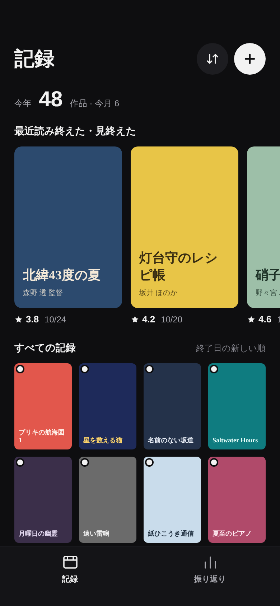

- 見出し「記録」（`screen-title`）。右に並び替え（アイコンボタン、`surface-2`）と記録する（白い＋、`accent`）。
- `YearCounter`: 「今年 48 作品 · 今月 6」。今年・今月に終了日がある記録の数。
- 「最近読み終えた・見終えた」: 終了日の新しい順に最大10件、`CoverCard` の `hero` を横スクロールで並べる。終了日のある記録がなければ、この段を出さない。
- 「すべての記録」: 右に今の並び順（「終了日の新しい順」など）を出す。`CoverCard` の `thumb` を4列で並べる。
- 書影をタップすると詳細へ。
- タブバー: 「記録」「振り返り」（`TabBar`）。

### 一覧（記録なし） — `records-list-empty.png`

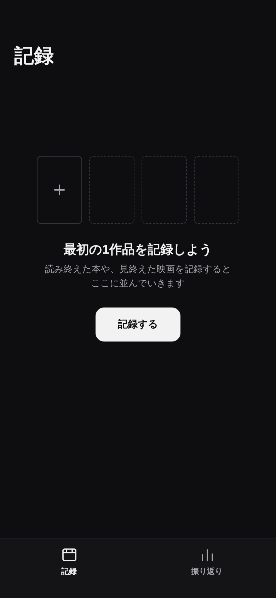

- `EmptyState`。点線の空の棚と、「最初の1作品を記録しよう」、「記録する」ボタン（＋と同じく追加シートを開く）。

### 何を記録しますか（追加の入口） — `add-sheet.png`

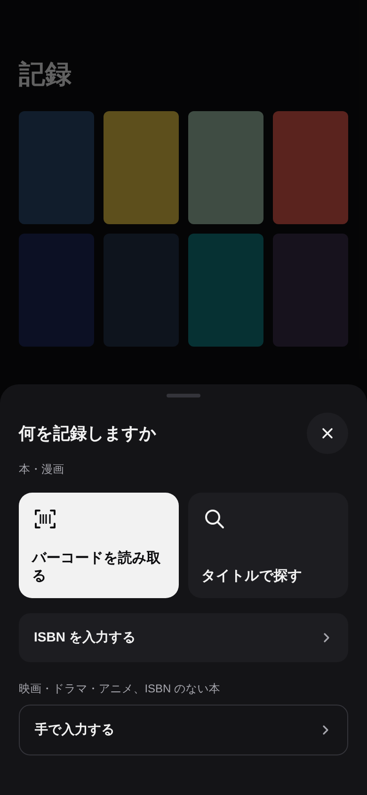

- 一覧の＋で開くボトムシート。背景は `scrim`。
- 「本・漫画」: 「バーコードを読み取る」（いちばん目立つ白い面）、「タイトルで探す」、「ISBN を入力する」。
- 「映画・ドラマ・アニメ、ISBN のない本」: 「手で入力する」。
- 閉じるボタンと、シートの外のタップ・下へのスワイプで閉じる。

### 並び替え — `sort-sheet.png`

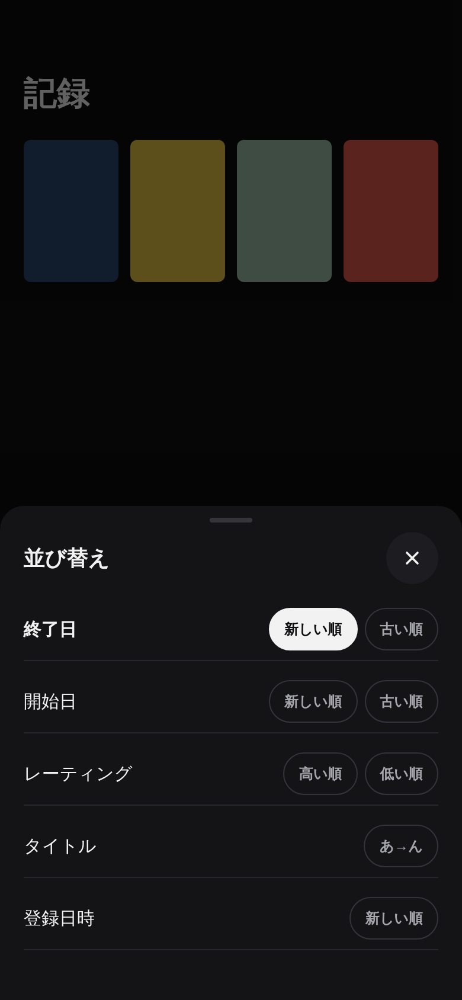

- 並び替えのボトムシート。項目は「終了日」「開始日」「レーティング」「タイトル」「登録日時」、それぞれに向き（新しい順／古い順など）を選ぶ。
- 選択中は白い面。選ぶとすぐ一覧に反映してシートを閉じる。並び順は今の実装どおり保存する。

## 詳細

### 詳細 — `record-detail.png`

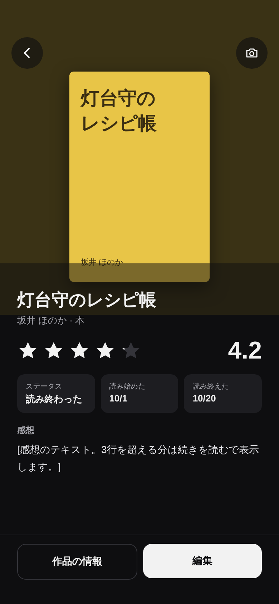

- 上部（`detail-hero-height`）: 書影から取った暗い色の地に、書影を大きく（196×294、`shadow-cover`）。画像がなければ文字の表紙。
  - 地の色は書影の代表色を暗くしたもの。取れなければ種別の `cover-<種別>-bg` を暗くしたもの、それも難しければ `surface-1`。
- 左上に戻る、右上に写真の変更（どちらも `scrim` の丸ボタン）。
- タイトル（`screen-title`）、「作者 · 種別」、星（`RatingStars` 表示用）と数字（`display-number`）。評価がなければ星の段を出さない。
- `InfoCell` 3つ: ステータス、読み始めた（見始めた）、読み終えた（見終えた）。日付が空なら「—」。
- 感想: 3行まで。続きは「作品の情報」で読む。感想がなければ段を出さない。
- 下に固定: 「作品の情報」（枠線）、「編集」（白）。

### 作品の情報 — `record-detail-info.png`

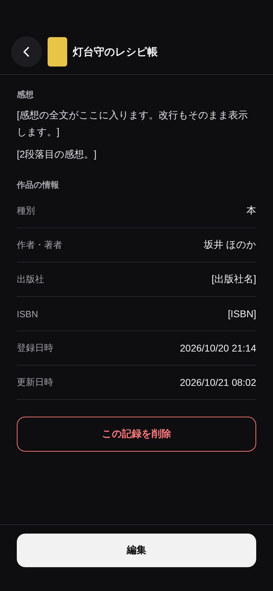

- 詳細の下側。上に小さな書影とタイトル。
- 感想の全文（改行をそのまま）。
- 「作品の情報」: 種別、作者・著者（映画などは「監督など」）、出版社、ISBN、登録日時、更新日時。空の項目は行ごと出さない。
- 「この記録を削除」（`danger` の文字と枠）。
- 実装は、詳細画面を下へスクロールした続きでも、別の画面でもよい（仕様書で決める）。

### 削除の確認 — `delete-confirm.png`

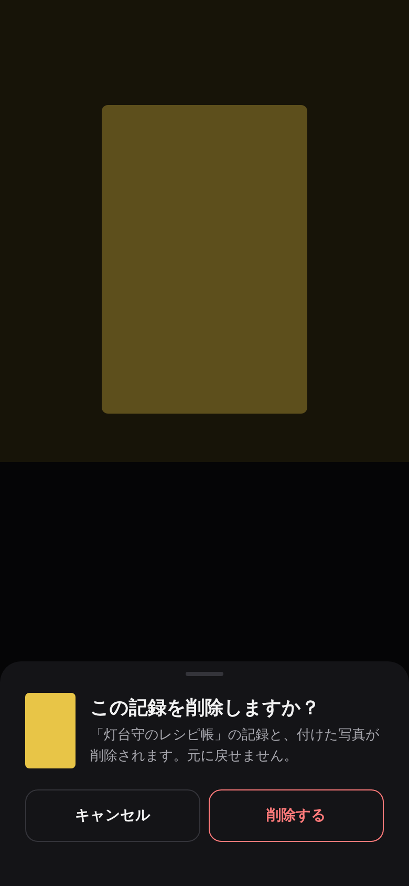

- ボトムシート。「この記録を削除しますか？」「「<タイトル>」の記録と、付けた写真が削除されます。元に戻せません。」
- 「キャンセル」（枠線）と「削除する」（`danger` の文字と枠）。削除したら一覧へ戻り、触覚フィードバックを1回。

## 追加・編集

### 記録を追加 — `record-form-new.png`

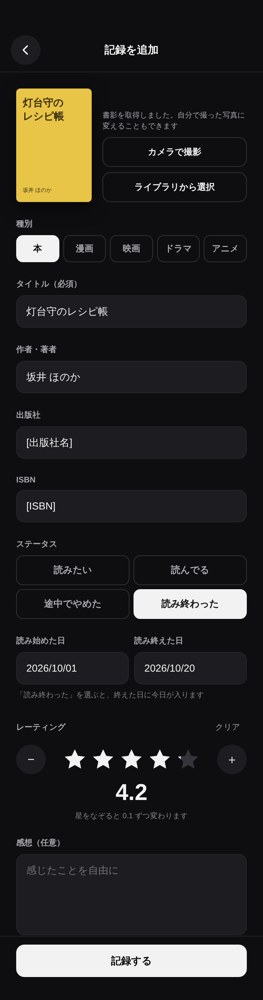

- ISBN・バーコード・タイトル検索から来たときは、取得した値が入った状態で開く。手入力のときは空。
- 上: 書影（112×168）と「カメラで撮影」「ライブラリから選択」。書影を取得できたときは「書影を取得しました。自分で撮った写真に変えることもできます」。
- 種別: 5つのチップ（選択中は白）。ステータス: 4つのチップ（2列）。種別に合わせて「読」「見」を切り替える。
- タイトル（必須）、作者・著者（映画などは「監督など」）、出版社、ISBN。出版社と ISBN は本・漫画のときだけ出す。
- 日付: 2つ並べる。タップで日付の選択を開く（「今日」「クリア」は選択の中に置く）。「読み終わった／見終わった」を選んで終えた日が空なら、今日を入れる。
- レーティング: `RatingStars` の入力用（38px、なぞって 0.1 刻み）、左右に −／＋（0.1 ずつ）、右上に「クリア」、下に数字。
- 感想（任意）。
- 下に固定: 「記録する」（白）。保存したら詳細へ。

### 記録を編集 — `record-form-edit.png`

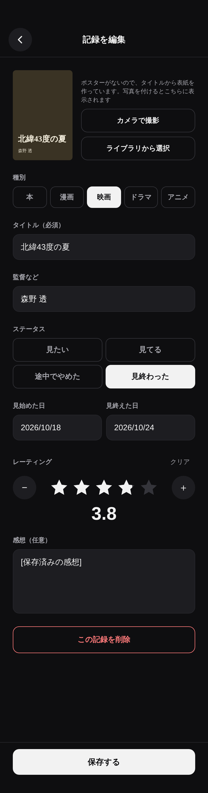

- 追加と同じ並び。見出しは「記録を編集」、ボタンは「保存する」。
- 画像がないときは文字の表紙と「ポスターがないので、タイトルから表紙を作っています。写真を付けるとこちらに表示されます」。
- 写真を付けているときは「写真を削除」も出す（今の実装どおり）。
- いちばん下に「この記録を削除」（削除の確認へ）。

## 本・漫画を探す

### カメラの許可 — `scan-permission.png`

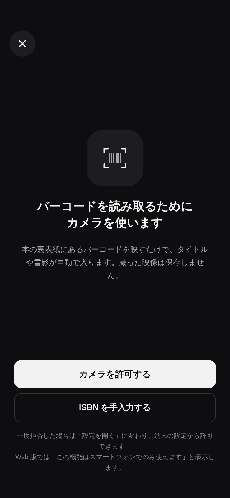

- 「バーコードを読み取るためにカメラを使います」と説明。「カメラを許可する」（白）、「ISBN を手入力する」（枠線）。
- 一度拒否されたあとは、「カメラを許可する」を「設定を開く」に変える（端末の設定を開く）。
- Web 版では、許可の代わりに「この機能はスマートフォンでのみ使えます」と「ISBN を手入力する」を出す。

### バーコード読み取り — `scan.png`

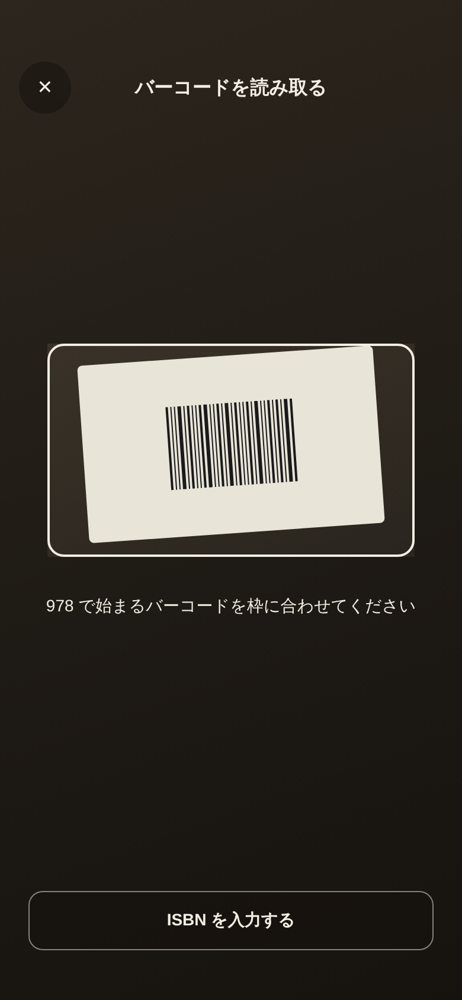

- 全画面のカメラ。枠の外を暗くし、白い枠と読み取り線を出す。
- 「978 で始まるバーコードを枠に合わせてください」「読み取れたら自動で書誌情報を探します」。
- 上: 閉じる、タイトル、ライト（端末が対応していれば）。下: 「ISBN を手入力する」。
- 読み取ったら書誌情報を探し、見つかれば記録を追加（値が入った状態）へ、なければ「見つかりませんでした」へ。

### ISBN を入力する — `isbn.png`

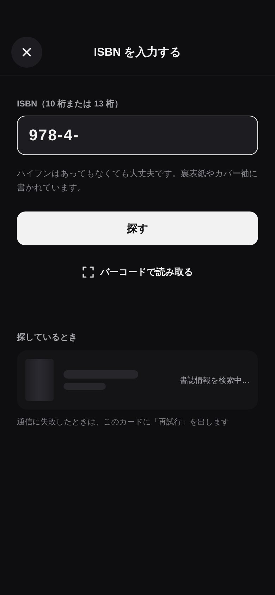

- 「ISBN（10 桁または 13 桁）」の大きな入力欄（数字キーボード）。ハイフンはあってもなくてもよい。
- 「探す」（白）。「バーコードで読み取る」への切り替え。
- 探している間は、下に骨組みのカードと「書誌情報を検索中…」。通信に失敗したら、このカードに「再試行」を出す。
- 入力の誤り（桁数・チェックディジット）は入力欄の下に出す（今の実装の文言を使う）。

### 見つかりませんでした — `isbn-not-found.png`

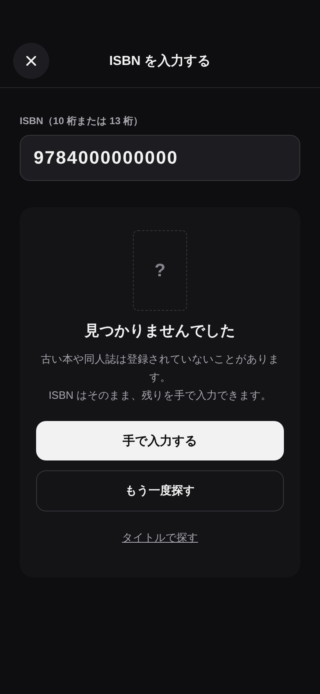

- 「見つかりませんでした」「古い本や同人誌は登録されていないことがあります。ISBN はそのまま、残りを手で入力できます。」
- 「手で入力する」（白、ISBN を入れた状態で記録を追加へ）、「もう一度探す」（枠線）、「タイトルで探す」。

### タイトルで探す — `title-search.png`

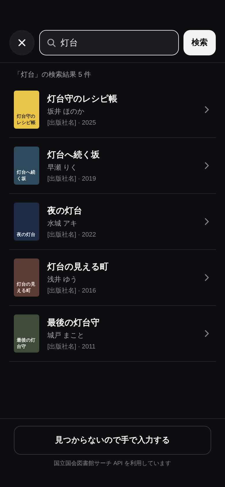

- 上に閉じる・検索欄・「検索」。結果の件数。
- 結果の行: 小さな書影（なければ文字の表紙）、タイトル、作者、「出版社 · 出版年」。タップで記録を追加（値が入った状態）へ。
- 検索中・見つからない・通信の失敗は、今の実装と同じ状態を持つ（見た目はこの画面に合わせる）。
- 下に固定: 「見つからないので手で入力する」、「国立国会図書館サーチ API を利用しています」。

## 振り返り（タブ、旧・分析）

### 振り返り — `review.png`

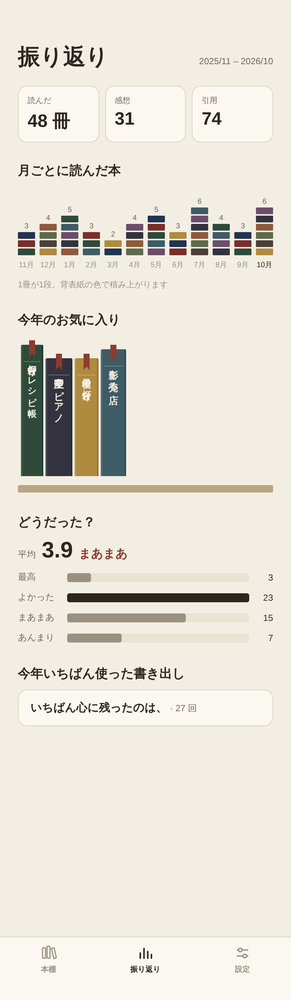

- 見出し「振り返り」と対象期間（直近12か月）。
- 上に2つの数字: 「この1年で終えた N 作品」「平均レーティング」。
- 月別の完了数: 12か月の積み上げ棒。種別ごとに灰色の濃さを変える（本がいちばん明るく、アニメがいちばん暗い）。凡例を下に。今月のラベルだけ白。
  - 灰色の5段階はトークンにないため、実装時に仕様書の判断ログで提案し、人間がトークンを追加するまでは `text-primary` / `text-secondary` / `text-tertiary` / `line-strong` / `surface-2` で代える。
- 「終了日が未入力の記録: N 件」と「入力する」（一覧へ）。0件なら出さない。
- レーティング: 1点台〜5点台の横棒（最も多い段だけ白）と件数。種別ごとの作品数と平均。

### 振り返り（記録なし） — `review-empty.png`

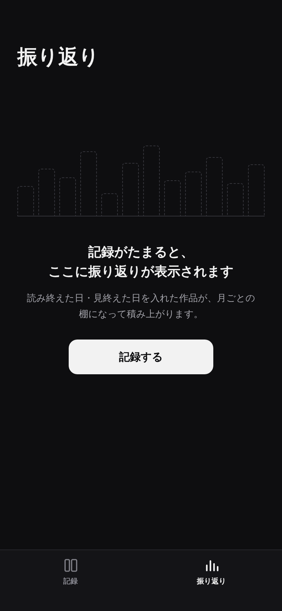

- 点線の空の棒グラフと、「記録がたまると、ここに振り返りが表示されます」、「記録する」（追加シートを開く）。

## 設定（タブ）

設定は、端末の中に保存する。設定画面ができるまでは、すべて初期値（すべての種別・すべての項目を使う、ステータスの初期値「読み終わった・見終わった」、上の段「最近読み終えた・見終えた」）で動く。

### 設定 — `settings.png`

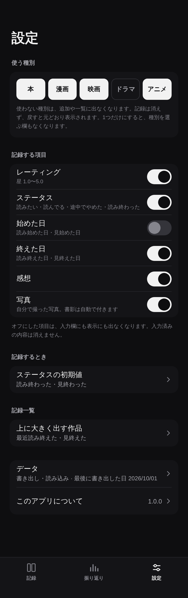

- 見出し「設定」（`screen-title`）。タブバーは3つで「設定」が選択中。
- 項目は、面 `surface-1` の角丸のカードにまとめ、カードの上に小さな見出しを置く。
- 「使う種別」: 5つの `Chip`（複数選択）。最後の1つは外せない。下に説明文。
- 「記録する項目」: `Toggle` の行。レーティング、ステータス、始めた日、終えた日、感想、写真。行の下に補足（種別で変わる言い方など）。カードの下に「オフにした項目は、入力欄にも表示にも出なくなります。入力済みの内容は消えません。」
- 「記録するとき」: 「ステータスの初期値」の行（今の値を2行目に）。ステータスの項目がオフのときは出さない。
- 「記録一覧」: 「上に大きく出す作品」の行（今の値を2行目に）。
- 最後のカード: 「データ」（2行目に「書き出し・読み込み · 最後に書き出した日 <日付>」。書き出したことがなければ「まだ書き出していません」）と「このアプリについて」（右にバージョン）。
- **「すべての記録を削除」は、このトップには置かない**（データの画面のいちばん下）。

### ステータスの初期値 — `settings-status-default.png`

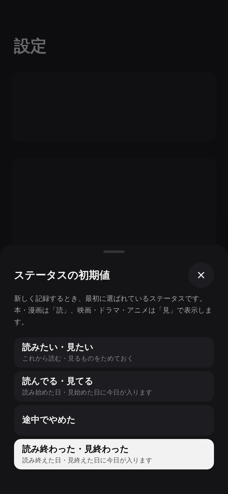

- `BottomSheet`。4つから1つを選ぶ（選択中は白い面とチェック）。選ぶとすぐ保存して閉じる。
- 表示は「読みたい・見たい」のように両方の言い方を並べる。新しい記録のフォームでは、種別に合わせて片方を出す。
- 「読んでる・見てる」なら始めた日に、「読み終わった・見終わった」なら終えた日に、今日が入る（その日付の項目がオンのとき）。

### 上に大きく出す作品 — `settings-hero.png`

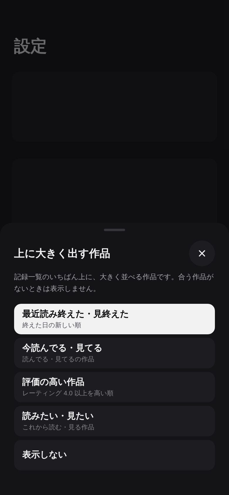

- `BottomSheet`。条件を1つ選ぶ。候補は「最近読み終えた・見終えた」（初期値）、「今読んでる・見てる」、「評価の高い作品」、「読みたい・見たい」、「表示しない」。
- 記録する項目でオフにした項目に基づく条件（レーティングがオフなら「評価の高い作品」など）は出さない。

### このアプリについて — `about.png`

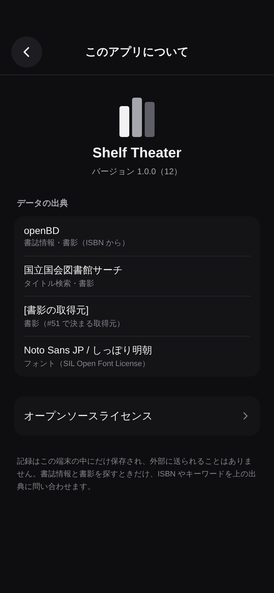

- アプリ名、バージョン（ビルド番号）。
- 「データの出典」: openBD、国立国会図書館サーチ、書影の取得元、フォント（ライセンス名）。利用規約が求める表記があれば、それに合わせる。
- 「オープンソースライセンス」: 使っているライブラリのライセンスの一覧へ。
- 下に「記録はこの端末の中にだけ保存され、外部に送られることはありません。…」の説明。

### データ — `settings-data.png`

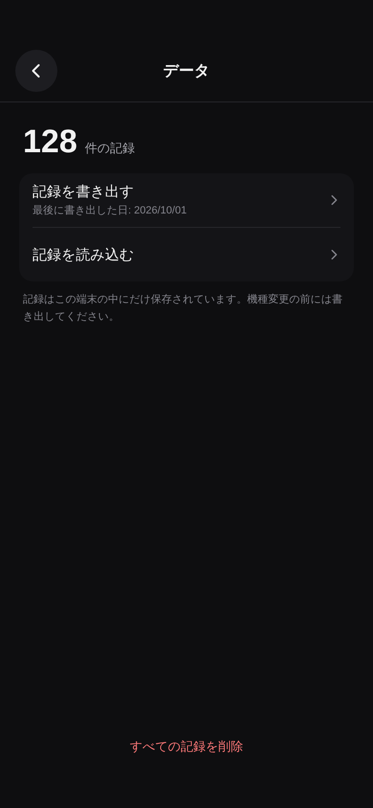

- 記録の件数（`display-number`）。「記録を書き出す」（2行目に最後に書き出した日）、「記録を読み込む」。
- 「記録はこの端末の中にだけ保存されています。機種変更の前には書き出してください。」
- 画面のいちばん下に「すべての記録を削除」。**文字だけ（`danger` の文字、枠も面もなし）で目立たせない**。タップ領域は 44px 以上。

### 記録を書き出す — `export.png`

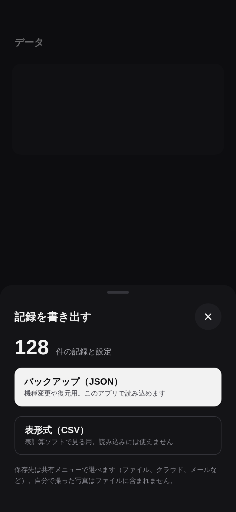

- `BottomSheet`。件数と、2つの形式。
  - 「バックアップ（JSON）」（白い面）: 記録と設定をすべて含む。このアプリで読み込める。
  - 「表形式（CSV）」（枠線）: 表計算ソフトで見る用。読み込みには使えない。
- 選ぶとファイルを作り、端末の共有メニューを開く（保存先はユーザーが選ぶ）。
- 自分で撮った写真はファイルに含めない（その旨を説明文に書く）。

### 記録を読み込む — `import.png`

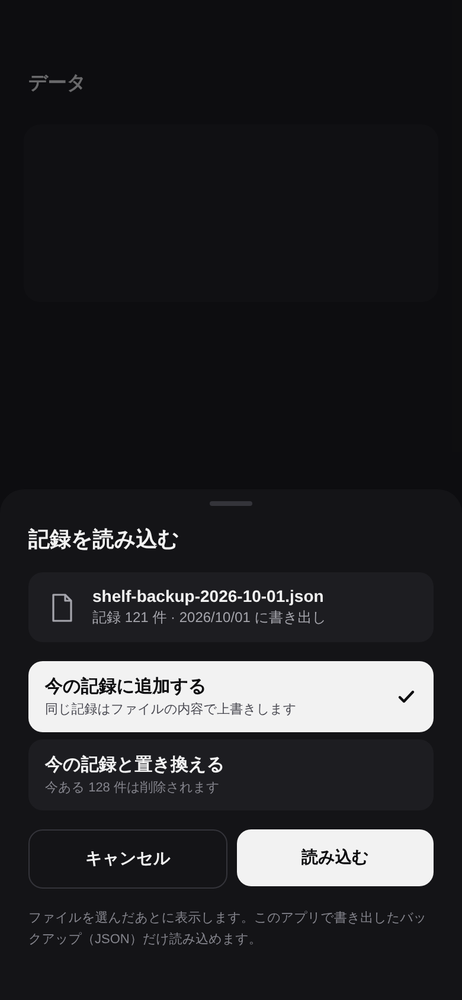

- 「記録を読み込む」でファイルを選んだあとに出す `BottomSheet`。
- ファイル名と、中身の件数・書き出した日。
- 「今の記録に追加する」（初期値。同じ記録はファイルの内容で上書き）か「今の記録と置き換える」（今ある記録は削除）を選ぶ。
- 「キャンセル」「読み込む」。このアプリのバックアップでないファイル・壊れたファイルは、読み込まずにその旨を出す。

### すべての記録を削除 — `delete-all.png`

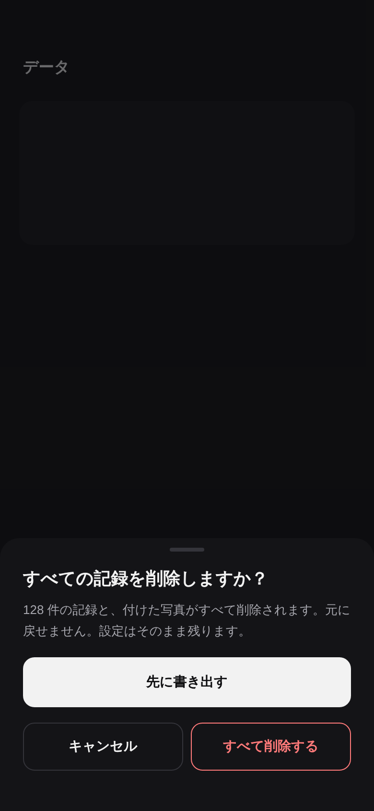

- `BottomSheet`。「すべての記録を削除しますか？」「<N> 件の記録と、付けた写真がすべて削除されます。元に戻せません。設定はそのまま残ります。」
- 「先に書き出す」（白い面、書き出しへ）、「キャンセル」（枠線）、「すべて削除する」（`danger` の文字と枠）。
- 削除したら記録一覧（記録なしの状態）へ。触覚フィードバックを1回。
