# 画面デザイン（書斎）

アプリの画面のデザイン。画像は幅 390px（2倍で書き出し）。縦に長い画面は、スクロールしきった全体を1枚にしている。

- 画面を作る・変えるときは、該当する画像と下の説明を見て、その見た目に合わせる。
- 色・文字・余白・角丸は画像から読み取らず、`app/src/design/tokens.ts` のトークンを使う。
- 使う部品は `../components/`（Spine、Shelf、Hint、Quote、MemoRow、RatingStars、Button、Chip、Toggle、TextField、BottomSheet、TabBar、EmptyState）。**画像と部品の README が食い違うときは、部品の README を優先する。**
- 画像の本・作者・文章はサンプル。`[出版社名]` `[ISBN]` は実際の値が入る場所。
- 元データは claude.ai のデザインキャンバスの「読後ノート 全画面（案1）」ページ（読後メモまわりは「読後メモ（改善案）」ページ）。直したら、ここの画像も書き出し直す。

## 前のデザインから変わる点（まとめ）

| 変わる点 | 前 | 書斎 |
| --- | --- | --- |
| 扱うもの | 本・漫画・映画・ドラマ・アニメ | **本だけ**（漫画も本として扱い、区別しない） |
| 一覧 | 書影の4列グリッド、大きく出す作品の横並び | **背表紙の棚**。上部で本棚（すべての本／自分で作った本棚）とステータスを切り替える |
| 本の分類 | 種別 | **本棚（タグ）**。1冊を複数の本棚に入れられる |
| 書影 | 主役 | 使わない（背表紙の色を本ごとに選ぶ） |
| 感想 | 自由記述の1欄 | **この本をひとことで**と**読後メモ**（ヒントを入れながら書く文章のリスト）。読みながらはメモと引用 |
| 評価 | 「評価」と数字 | 「どうだった？」と数字＋言葉（最高・よかった・まあまあ・あんまり） |
| 勧めたい | 「人に勧めたい」 | **お気に入り**（背表紙に朱の栞） |
| 詳細画面 | 書影が主役 | **読み返す画面**（この本をひとことで → 読後メモ → メモと引用） |
| 地の色 | 黒 | 生成りの紙 |
| 設定 | 使う種別、記録する項目、大きく出す作品 など | ステータスの初期値、本棚の管理、並び順、データ、このアプリについて |

## 本棚と本を追加

### 本棚 — `shelf.png`

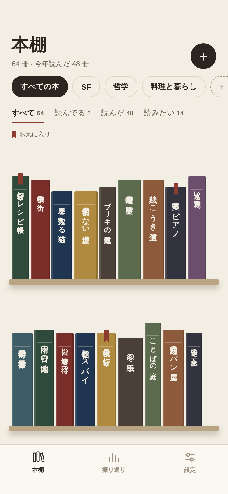

- 見出し「本棚」（`screen-title`）と「64 冊 · 今年読んだ 48 冊」。右上に丸い追加ボタン。
- 本棚の切り替え（`Chip` の切り替え）: 「すべての本」「SF」「哲学」…、最後に「＋ 本棚を作る」。
- ステータスの絞り込み（下線のタブ）: 「すべて」「読んでる」「読んだ」「読みたい」と件数。初期値は「すべて」。
- 凡例は「お気に入り」（栞）だけ。
- `Shelf` に `Spine` を並べる。背表紙をタップすると、読んでる本は「読んでる本」、それ以外は「読み返す」へ。

### 本棚（本がない） — `shelf-empty.png`

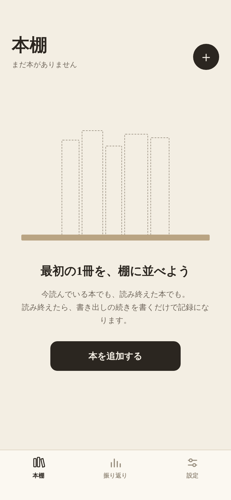

- `EmptyState`: 点線の空の背表紙、「最初の1冊を、棚に並べよう」、「本を追加する」。

### 本棚を作る — `shelf-new.png`

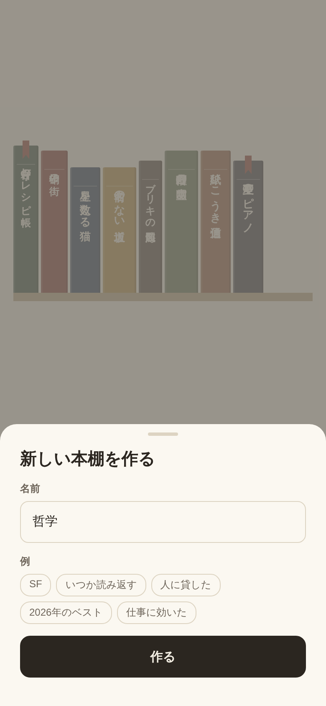

- `BottomSheet`。名前（明朝）と、例のチップ（押すと名前に入る）。「作る」。
- 同じ名前の本棚は作れない（その旨を出す）。

### 本棚を選ぶ — `shelf-pick.png`

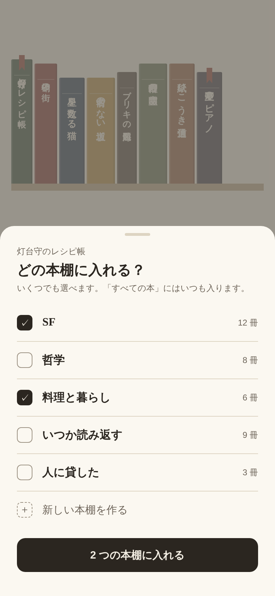

- 本の画面（読んでる本・読み返す）の「本棚」から開く `BottomSheet`。チェックで複数選び、各本棚の冊数を出す。
- 「すべての本」にはいつも入る（一覧に出さない）。シートの中から新しい本棚も作れる。
- 主ボタンは「2 つの本棚に入れる」のように、選んだ数を出す。

### 本を追加 — `add-sheet.png`

- `BottomSheet`。「バーコードを読み取る」（墨の主ボタン）、「タイトルで探す」「ISBN を入力する」「手で入力する」。

### バーコード — `scan.png`

- 全画面のカメラ。枠の外を暗くし、紙の色の枠を出す。「978 で始まるバーコードを枠に合わせてください」。下に「ISBN を入力する」。
- カメラの許可・Web の代替表示・見つからないときの流れは、今の実装を保ち、見た目だけ書斎に合わせる。

### タイトルで探す — `title-search.png`

- 検索欄と「検索」、件数。結果の行は、小さな背表紙（幅 22px）、タイトル（明朝）、「作者 · 出版社 · 年」。
- 下に「見つからないので手で入力する」と、国立国会図書館サーチのクレジット。

### 本を登録・編集 — `book-form.png`

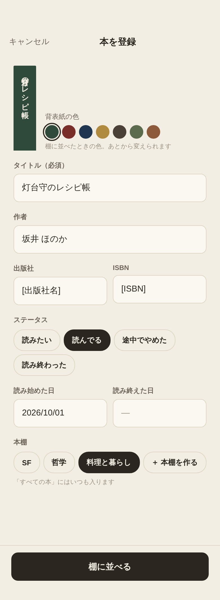

- 上に背表紙のプレビューと「背表紙の色」（`spine-1`〜`spine-10` の丸から選ぶ）。
- タイトル（必須・明朝）、作者、出版社、ISBN、ステータス（`Chip` 単一選択）、読み始めた日・読み終えた日、本棚（`Chip` 複数選択）。
- 感想・評価・写真はここで入力しない（読み終えたときと、読み返す画面で扱う）。
- 下に固定: 追加は「棚に並べる」、編集は「保存する」。編集のときは一番下に「この本を削除」（`danger` の文字ボタン）。

## 読む・読み終える・読み返す

### 読んでる本 — `reading.png`

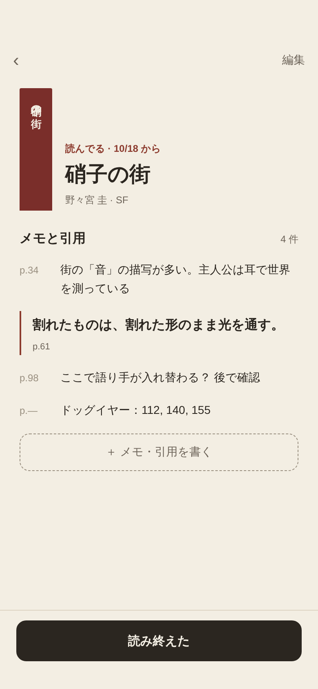

- 上に背表紙と、「読んでる · 10/18 から」（`ribbon`）、タイトル（`book-title`）、「作者 · 本棚」。右上に「編集」。
- 「メモと引用」と件数。`MemoRow` と `Quote` をページ順に並べる。
- 「＋ メモ・引用を書く」（点線ボタン）。
- 下に固定の主ボタン「読み終えた」。

### メモ・引用を書く — `note-sheet.png`

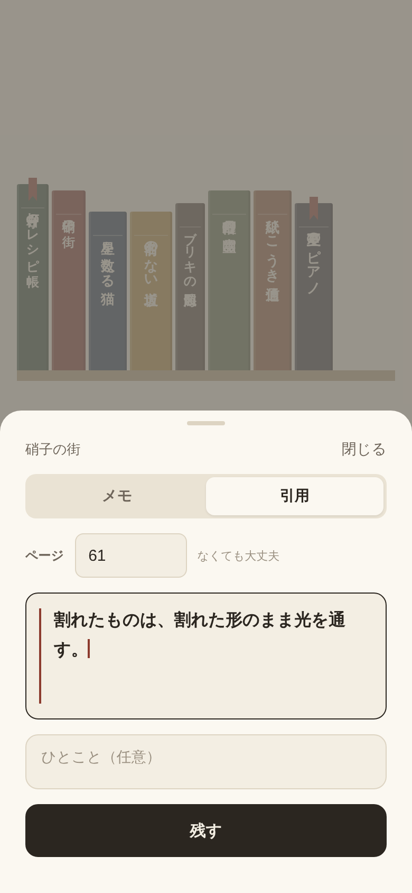

- `BottomSheet`。上に本のタイトルと「閉じる」。
- 「メモ」「引用」の切り替え。ページ（任意、「なくても大丈夫」）。
- 本文: 引用のときは左に `ribbon` の線、明朝。メモのときは UI の書体。
- 引用のときは「ひとこと（任意）」。主ボタン「残す」。

### 読み終えた — `finished.png`

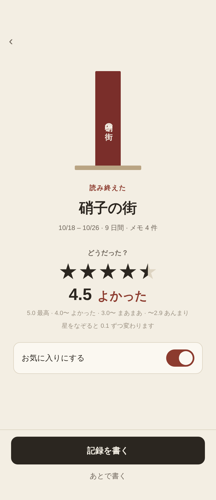

- 「読み終えた」を押したあとの画面。背表紙と棚板、「読み終えた」（`ribbon`）、タイトル、「10/18 – 10/26 · 9 日間 · メモ 4 件」。
- 「どうだった？」: `RatingStars` の入力、数字と言葉（「4.5 よかった」）、言葉の目安。
- 「お気に入りにする」（`Toggle`）。
- 下に固定: 主ボタン「記録を書く」（読後メモを書く画面へ）、「あとで書く」。
- 読み終えた日には今日を入れる（ここでは表示だけ。変えたいときは編集で）。

### 読後メモを書く — `write.png`

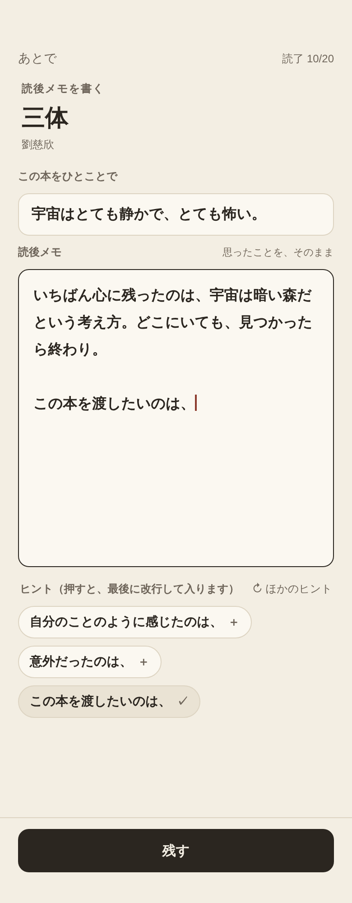

- 上: 「あとで」と「読了 M/D」。「読後メモを書く」、タイトル、作者。
- 「この本をひとことで」の欄（`one-line` の明朝、1〜2 行）。読後メモとは別の項目。すでにあれば入っている。
- 「読後メモ」の大きな入力欄が 1 つ（`reading` の明朝）。読み返す画面から開いたときは空で始める（書き足すと 1 件増える）。
- 入力欄の下に「ヒント」を 3 つ（`Hint`）。押すと今の文章の最後に改行して入る。「↻ ほかのヒント」。キーボードを開いているあいだは、ヒントの行をキーボードのすぐ上に出す。
- 下に固定の主ボタン「残す」。「あとで」で閉じても、書いた分は下書きとして残る。
- 「引用として残す」は置かない（引用は「メモと引用」から書く）。

### 読み返す — `reread.png`

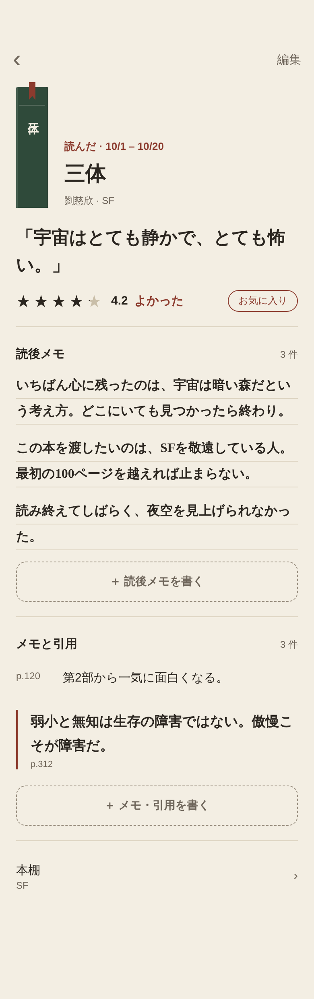

- 本の画面（読んだ・読みたい・途中でやめた本）。人に勧める前に、30 秒で思い出せることが目標。
- 上部は読んでる本の画面と同じ組み（背表紙、ステータスと日付、タイトル、「作者 · 本棚」）。右上に「編集」。
- 「この本をひとことで」（`one-line`、「」付き）を一番大きく。その下に星・数字・言葉と「お気に入り」の印。どちらも押すと、直すシートが開く。
- 区切り線の下に「読後メモ」の段と件数。読後メモを書いた順に、`reading` の明朝・罫線付きで並べる（ヒントから入れた文も区別しない）。押すと「読後メモを直す」。段の最後に「＋ 読後メモを書く」（点線のボタン）。
- 区切り線の下に「メモと引用」の段と件数（読んでる本の画面と同じ並べ方・ページ順）。段の最後に「＋ メモ・引用を書く」。
- 一番下に「本棚」の行。

### 読み返す（読後メモなし） — `reread-empty.png`

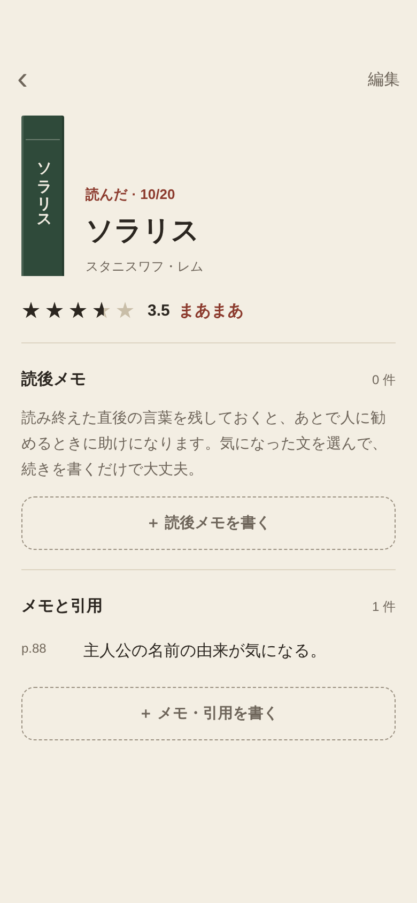

- 「読後メモ」の段の中に、案内（「読み終えた直後の言葉を残しておくと、あとで人に勧めるときに助けになります。…」）と「＋ 読後メモを書く」だけを出す。

### 読後メモを直す — `memo-edit.png`

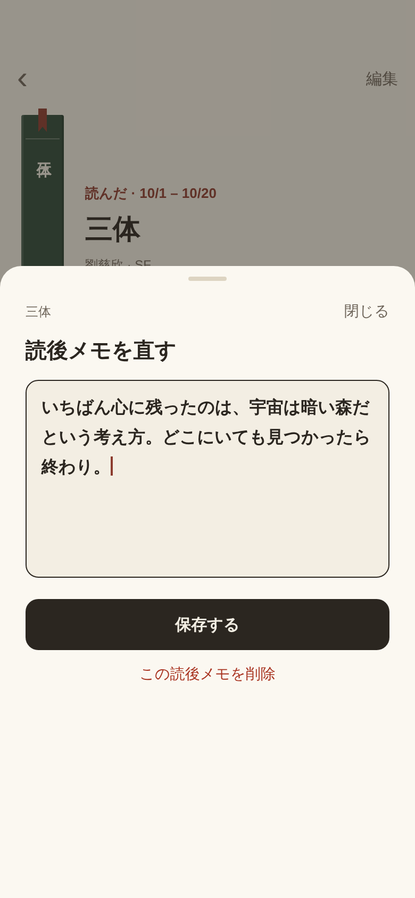

- 読み返す画面で読後メモを押すと開く `BottomSheet`。上に本のタイトルと「閉じる」、見出し「読後メモを直す」。
- 入力欄は 1 つ（全文。`reading` の明朝）。主ボタン「保存する」、下に「この読後メモを削除」（`danger` の文字ボタン、確認あり）。

### この本をひとことで・どうだった？を直す — `oneline-edit.png`

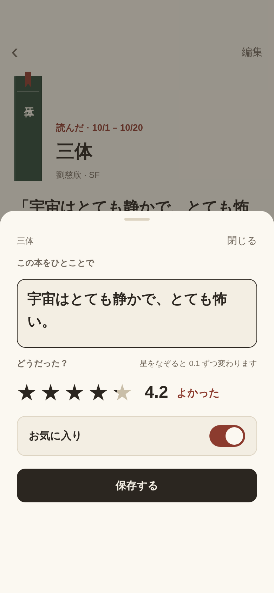

- 読み返す画面でひとことか評価を押すと開く `BottomSheet`。
- 「この本をひとことで」の入力欄、「どうだった？」の `RatingStars`（なぞって 0.1 刻み）と数字・言葉、「お気に入り」の `Toggle`。主ボタン「保存する」。

## 振り返りと設定

### 振り返り — `review.png`

- 見出し「振り返り」と期間（直近 12 か月）。
- 3つの数字: 読んだ（冊）、感想（読後メモを1件以上書いた本の数）、引用。
- 「月ごとに読んだ本」: 1冊を1段にして、その本の背表紙の色で積み上げる。今月のラベルだけ墨。
- 「今年のお気に入り」: お気に入りの本を `Shelf` で並べる。
- 「どうだった？」: 平均（数字と言葉）と、最高・よかった・まあまあ・あんまり の冊数（いちばん多い段だけ墨）。

### 設定 — `settings.png`

- 「読み終えたら」: ステータスの初期値。（画像にある「書き出し」の行はなくした）
- 「本棚」: 本棚の管理（名前の変更・並べ替え・削除）、並び順。
- 最後のカード: データ（書き出し・読み込み・すべての記録を削除）、このアプリについて。
- データ・書き出し・読み込み・すべての記録を削除・このアプリについての各画面は、今の実装の構成のまま、見た目だけ書斎のトークンに合わせる（画像なし）。
